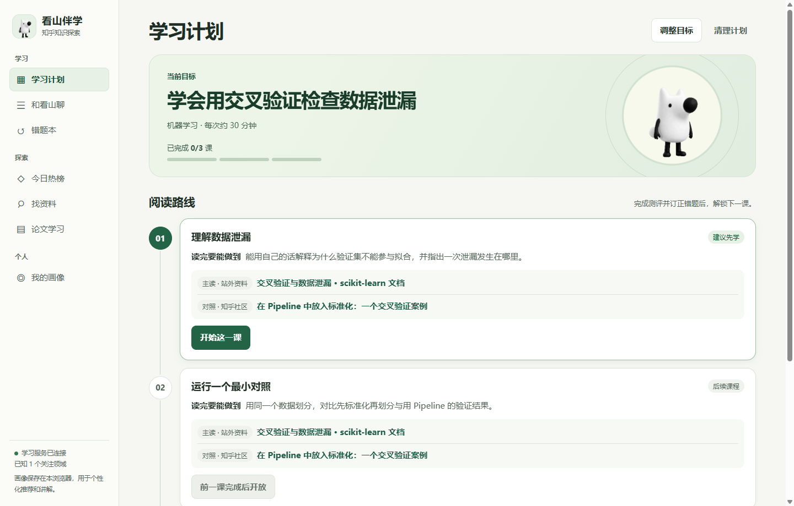
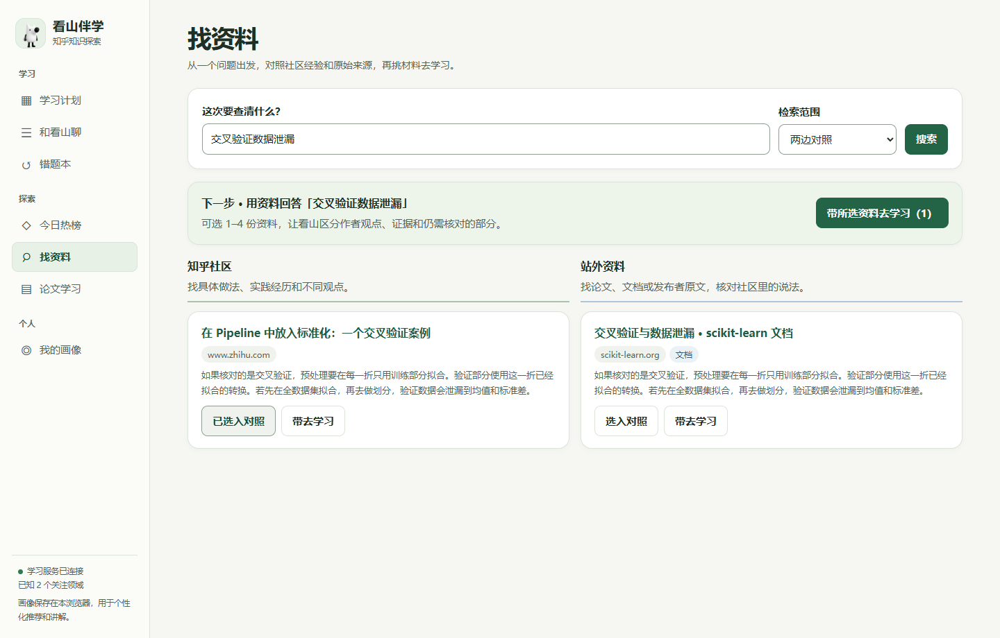
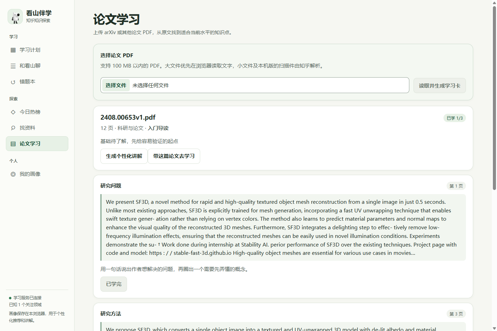
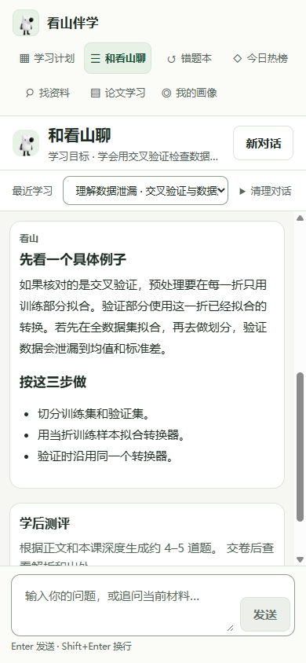

# 看山伴学

看山伴学把知乎的真实问答、社区经验和站外资料连成一条可继续的学习路线。给它一个具体目标，它会帮你选资料、安排阅读顺序，学完后用有出处的测评和错题订正检查进度。



*界面示例。目标「学会用交叉验证检查数据泄漏」被拆成理解概念、运行最小对照和检查结果三课。*

## 它怎样用知乎

| 学习入口 | 使用的能力 | 你可以做什么 |
| --- | --- | --- |
| 今日热榜 | 知乎热榜、问题下的回答摘要 | 先看问题和社区观点，点击「想深入」进入对话，围绕当前学习方向梳理概念、证据和分歧 |
| 找资料 | 知乎搜索、全网搜索 | 把社区实践与站外文档、论文或发布者原文并排看；选择 1–4 份资料，带入同一段学习对话 |
| 学习计划 | 知乎搜索、全网搜索、知乎直答 | 根据目标和已有经历排三课，每课有主读、可能的对照资料及学习任务；通过测评并订正后继续下一课 |
| 和看山聊 | 知乎直答 | 围绕所选资料生成讲解、回应追问，并按可用证据生成学后测评 |
| 论文学习 | 浏览器 PDF.js、知乎 PDF 解析、知乎直答 | 读原文学习卡、按页定位证据，选择生成个性化讲解或带入对话 |

接口和凭证申请入口见 [知乎开发者平台](https://developer.zhihu.com/) 和 [知乎搜索文档](https://developer.zhihu.com/docs?key=zhihu_search)。同一篇材料的社区观点与可核查证据分别呈现。遇到生成额度不足时，有原文材料的课仍可使用本地导读和可核查的题目。

## 安装与启动

需要 **Node.js 22.13 或以上版本**。源码方式还需要 Git。服务监听本机，默认地址为 [http://localhost:5173/](http://localhost:5173/)，按 **Ctrl+C** 停止。

### 从 Git 克隆

```powershell
git clone https://github.com/westerfeld44629/kanshan-study-companion.git
cd kanshan-study-companion
npm ci --include=dev
npm start
```

`npm ci` 会构建网页。先打开终端显示的地址即可浏览页面；使用知乎联网功能前按下节配置凭证并重启。

### 安装 `kanshan` 命令

已有 `.tgz` 时，在安装包所在目录执行后两行。从源码构建安装包时，先按上面的步骤安装依赖，再在项目根目录执行全部命令。

```powershell
npm pack
npm install -g ./kanshan-study-companion-0.1.0.tgz
kanshan start
```

默认端口被占用时，终端会显示实际地址。浏览器按地址保存学习记录；继续原有记录时请访问原地址。可用 `kanshan start --port 5173` 指定端口。

### 配置知乎凭证

从知乎开发者平台取得自己的 **Access Secret**。将源码目录的 `.env.example` 复制为 `.env.local`，填写 `ZHIHU_ACCESS_SECRET`。安装包用户也可以在启动目录自行创建这个文件，内容见下方示例。

```dotenv
ZHIHU_ACCESS_SECRET=
ZHIDA_DAILY_BUDGET=60
```

`ZHIDA_DAILY_BUDGET` 控制应用的每日生成预算，默认 60。它与知乎账户的上游额度分别计数。全局命令会查当前目录的 `.env.local`，也支持用户主目录下的 `.kanshan/.env.local`。已有配置放在别处时，可显式指定。

```powershell
kanshan start --config "配置文件的完整路径"
```

凭证只由本机 Node 服务读取。请把自己的凭证保存在本机配置中。

## 试着完成一次学习

### 1. 从目标开始

首次打开时填写方向、一个具体目标、已有经历和单次可用时间。例如「用交叉验证检查标准化造成的数据泄漏」，比「学机器学习」更容易检索到可以跟做的资料。在「学习计划」打开当前课，阅读主读材料，追问一个卡点，然后完成学后测评。错题本保留解析和出处，订正后解锁下一课。三课完成后，按方向做一份可检查的结课实战。


### 2. 从热点或一个问题开始

「今日热榜」可以先打开问题看回答摘要，再点「想深入」。「找资料」默认并排展示知乎社区和站外资料。可以在社区栏找做法和失败经验，再用站外原文核对版本、条件和结论，最后把选中的材料带入对话。



*界面示例。「知乎社区」和「站外资料」各保留来源，选中的结果可一起带去学习。*

### 3. 用论文练习读证据

在「论文学习」选择 arXiv 或其他 PDF，单文件上限 100 MB。大文件优先尝试在浏览器读取文字层；需要云端解析的文件由本机服务提交给知乎。学习卡保留原文和页码，适合按研究问题、方法、结果和限制逐步阅读。带进对话后，可进一步追问或做至少 10 题的论文测评。可用证据不足时，页面会提示重试或换资料。



*按学习卡的页码回到论文原文。* [示例论文 SF3D](https://arxiv.org/abs/2408.00653)

### 4. 下次接着学

明确说出「以后先举个具体例子再解释原理」之类的偏好，或者在测评中订正一个知识点，看山会在之后的相关学习中召回这些信息。「我的画像」可查看或清空自动记忆。学习计划、对话和学习记忆可以分别清理。



*手机界面示例。聊天底部可以追问，上方保留资料与已生成的内容。*

## 本地数据与开发

画像、学习计划、错题、聊天和学习进度保存在当前浏览器。联网检索使用输入的关键词。生成讲解和测评时，本机服务会把当前问题、所选资料和相关学习摘要交给知乎直答。需要知乎解析的 PDF 会由本机服务转交。浏览器完成文字提取的 PDF 可直接查看本地学习卡。

前端使用 React、TypeScript 和 Vite。安装版的 Node 服务同时提供网页和同源 API。开发时可通过 `npm run dev:full` 启用热更新。

```powershell
npm run dev:full
npm exec -- tsc --noEmit
node scripts/test-study-plan.mjs
node scripts/test-paper.mjs
```
